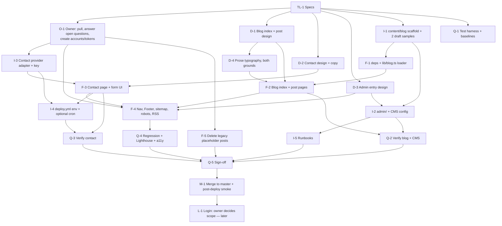

# 00 — Overview and architecture decision

Owner: Tech Lead · Status: draft for owner review · Written 2026-10-17

Read this first. Specs `01`–`04` assume everything here. Task state lives in [STATUS.md](STATUS.md).

---

## 0. Read this before anything else: the premise was out of date

The brief and the repo's untracked `CLAUDE.md` describe a **Jekyll** site with `_posts/` and `_data/navigation.yml`. That is the *local checkout*, which is 25 commits behind `origin/master`.

What is actually live (verified via `git fetch`, `git show origin/master:…`, and the Pages API — `build_type: "workflow"`, last deploy success 2026-10-01):

| Brief says | Reality on `origin/master` |
|---|---|
| Jekyll on GitHub Pages | **Next.js 16 (App Router, React 19, Tailwind v4), `output: "export"`**, deployed by `.github/workflows/deploy.yml` (pnpm, Node 22) since v1.0.0 on 2026-09-05 |
| `_posts/` holds template placeholders that must be cleaned | The Jekyll tree was moved to `_legacy-jekyll/`; it is **not built or served**. The placeholders now sit in `_legacy-jekyll/_posts/` and `_legacy-jekyll/_drafts/` |
| Add a Blog link to `_data/navigation.yml` | Nav is `nav` in `lib/site.ts`. **"Blogs" is already in it**, pointing at `app/blog/page.tsx`, which renders "Coming soon." It is publicly live today |
| (not mentioned) | `DEVELOPMENT.md` already plans **Phase 3: Notion as CMS** and **Phase 4: blog and gallery**. The owner has an existing intent here |
| (not mentioned) | Contact = a `mailto:` link in the footer only (`swatsa@ucsd.edu`) |

**Consequences for this plan**

1. All specs target the Next.js codebase. Nothing here applies to the Jekyll files.
2. "Clean up `_posts/`" becomes: delete `_legacy-jekyll/_posts/` and `_legacy-jekyll/_drafts/` (task F-5). Deleting all of `_legacy-jekyll/` is a separate owner decision (Q6).
3. "Add a Blog link" is already done; what remains is making the page real and deciding whether the link stays visible while empty (Q9).
4. **Step 0 for the owner:** `git pull` (it is a clean fast-forward: local master is 0 ahead / 25 behind). The untracked `CLAUDE.md` describes the wrong stack and should be rewritten after the pull. This task did not touch it, per the "only create files under `docs/`" rule.
5. Because `master` deploys on every push, **nothing may reach `master` before QA sign-off**. See §6.

Constraints inherited from the real stack (see `DEVELOPMENT.md`, and Next's [static-export docs](https://nextjs.org/docs/app/guides/static-exports)):

- **No server at runtime.** No Server Actions, no cookies, no request-reading Route Handlers, no rewrites/redirects/headers config, no ISR, no Draft Mode. Only `GET` Route Handlers with `export const dynamic = "force-static"` work (that is how `sitemap.ts`/`robots.ts` already work).
- **Every byte in `out/` is public**, including anything in `NEXT_PUBLIC_*`. There is no such thing as a browser-side secret.
- **The repo is public.** Anything committed — including `draft: true` posts and their git history — is readable by anyone.
- `AGENTS.md` warns that this Next.js version has breaking changes; implementers must read the relevant guide in `node_modules/next/dist/docs/` before writing code.

---

## 1. Goals

| # | Goal (from owner) | Definition of done |
|---|---|---|
| G1 | Contact form: visitors can contact me about anything | A `/contact/` page; a visitor can submit name, email and message; it lands in the owner's inbox; spam is controlled; works without costing money |
| G2 | Blog management: write, edit, publish without hand-editing files | Owner opens `/admin/`, signs in, writes a post in a browser editor, flips Draft off, saves; the post is live within ~3 minutes with no terminal use. Blog index, post pages, RSS and sitemap all reflect it |
| G3 | Later: login management | A written roadmap (in `03`), a decision on what "login" means (Q5), and no v1 choice that blocks it. **Not built in this phase** |

## 2. Non-goals

- Visitor accounts, comments, newsletters, gated/private posts (G3 roadmap only).
- Migrating publications/projects/experience to a CMS (that is the existing Phase 3; this plan must not block it, see §4.2 "seam").
- Redesigning the site's visual identity. The YCbCr/ink-and-studio system is fixed.
- Gallery (stays out of scope; its route stays as is).
- Any paid service, any custom domain, any change to hosting (GitHub Pages stays).
- Editing site code **in this task** (docs only).

## 3. Current state (relevant parts only)

```
app/blog/page.tsx        "Coming soon." placeholder, metadata title "Blogs"
app/layout.tsx           fonts, inline theme script, MeshField canvas, Nav, Footer
components/Nav.tsx       maps `nav` from lib/site.ts; flex-wrap; active via pathname.startsWith
components/Footer.tsx    socials + mailto: "Get in touch"
components/PageHeader.tsx  label + display title + intro (every page uses it)
lib/site.ts              site, nav (6 items), socials
app/sitemap.ts           derived from `nav` only (posts would be omitted today)
app/robots.ts            allow all
app/globals.css          tokens (--ink --surface --line --luma --muted --cb --cr), .eyebrow .prose-body .display
package.json             next, react, framer-motion, clsx only; scripts: dev build start lint
.github/workflows/deploy.yml  build on push to master (+ nextjs-rebuild); deploy job only on master
_legacy-jekyll/_posts/*, _legacy-jekyll/_drafts/*   dead template placeholders (incl. a 2199 "future" post)
```

Not present: tests, form handling, MDX/Markdown pipeline, any `admin` route, RSS, content directory, `.env*` handling in CI.

---

## 4. Architecture decision

Criteria, in order: (1) stays on GitHub Pages and free, (2) owner never hand-edits files, (3) low ongoing maintenance for a single-author site, (4) small blast radius if a vendor changes terms, (5) fits the existing static-export constraints.

### 4.1 Feature 1 — Contact form

| Option | Cost | Maintenance | Risk | Notes |
|---|---|---|---|---|
| **A. Hosted form endpoint — Web3Forms** (recommended for v1) | Free: 250 submissions/mo, unlimited forms/domains, hCaptcha, 30-day history¹ | ~None. One public access key, tied to the destination inbox at signup | Quota can be burned by bots because the key is public; free tier has **no Turnstile/reCAPTCHA and (reportedly) no domain allow-list**¹; third party sees message contents | 30-minute setup. Swapping vendor = change one file (`lib/contact/provider.ts`) |
| A′. Formspree | Free: 50 submissions/mo¹ | None | Lower quota → easier to exhaust; otherwise same | Reasonable fallback if Web3Forms terms change |
| B. Own Cloudflare Worker + Turnstile + email API (e.g. Resend) | $0 within free tiers (Turnstile free, unlimited verifications — verified in Cloudflare docs; Workers/Resend limits to be verified at setup) | Medium: ~100 lines of code, two more accounts, secrets in Cloudflare, you own deliverability | Most control (Origin check, rate limit, real captcha) but you now operate a service | Upgrade path if A is spammed. Can be the same Worker later used for OAuth/login (§4.3) |
| C. Keep `mailto:` only | $0 | None | Fails the goal (no form), exposes the address to scrapers, depends on the visitor having a mail client | Stays as the **fallback** under A or B |
| D. Google Form / Apps Script | $0 | Fragile, off-brand, cannot be styled to the theme | Reject | |

¹ Third-party and vendor-page figures retrieved 2026-10-17; the Web3Forms and Formspree pricing pages were not directly verifiable (403 / secondary sources disagree). **Integrations must re-verify limits and the domain-restriction question at signup (task I-3) and record the result in `03` §2.**

**Decision: A (Web3Forms), behind a one-file adapter, with honeypot + time-trap + the provider's server-side filtering. Add hCaptcha only if QA/real traffic shows spam (Q4). Escalate to B only if quota exhaustion or spam occurs.**

### 4.2 Feature 2 — Blog authoring ("write, edit, publish without hand-editing files")

| Option | Cost | Maintenance | Risk | Fit |
|---|---|---|---|---|
| **A. Markdown in repo + Sveltia CMS at `/admin/`** (recommended) | $0 | Low. Static `admin/index.html` + `config.yml`; pin the CMS script version | Drafts are **publicly visible in the GitHub repo**; Sveltia is a young, largely single-maintainer project (fallback: Decap CMS reads a largely compatible `config.yml` — verify at fallback time); sign-in via GitHub token stored in browser `localStorage` | Publish = commit to `master` → existing `deploy.yml`. Deterministic builds, full git history/rollback, no build-time network dependency, no build secret |
| A′. Same, with **Decap CMS** | $0 | Medium: GitHub backend needs an OAuth proxy you host (Decap's docs point to a Cloudflare Worker template) because there is no Netlify | Same as A plus the proxy | Mature, but strictly more infrastructure for a sole author than A |
| B. **Notion as CMS** (the existing `DEVELOPMENT.md` Phase 3 plan) | $0 | Medium: Notion API client, block→HTML renderer, image download step (Notion file URLs are short-lived), token as repo secret, **plus a rebuild trigger** because a static site does not update when Notion does (scheduled cron or webhook relay) | Content lives outside git (no diff/rollback beyond Notion history); API/version churn breaks the build; publish latency = cron interval; **drafts stay private** (genuine advantage) | Best editor UX and best privacy for drafts. Also the natural path for publications/projects later |
| C. Headless SaaS (Sanity/Contentful) | Free tiers exist | Medium–high: schema, studio, tokens, client | Vendor lock-in; overkill for one author | Reject |
| D. Hand-edit Markdown | $0 | — | Violates G2 | Reject |
| E. Build a custom admin | $0 + days | High | Auth, storage, security all on us | Reject |

**Decision: A.** Rationale: one author, one content type; the lowest moving-part count; the build stays offline and reproducible; rollback is `git revert`. The two real costs of A are accepted knowingly:

1. **Drafts are public in the repo.** If that is unacceptable (Q2), switch to B — the architecture below makes that a source swap, not a rewrite.
2. **Token-based sign-in.** The owner pastes a fine-grained GitHub PAT (single-repo, *Contents: read & write* only, expiring) into the CMS. Sveltia's PKCE sign-in is [documented as not yet available](https://sveltiacms.app/en/docs/backends/github) (waiting on GitHub); when it ships, the token step disappears. A Worker-based OAuth flow is only needed for non-technical co-authors.

**The seam (what keeps B and the existing Phase 3 open).** The frontend never reads files directly. It imports one module:

```ts
// lib/blog.ts  (owned by Frontend) — the ONLY thing pages/components import
export type Post = {
  slug: string;            // URL segment, from filename
  title: string;
  date: string;            // ISO 8601
  updated?: string;        // ISO 8601
  summary: string;
  tags: string[];
  cover?: { src: string; alt: string };
  draft: boolean;
  readingMinutes: number;  // computed at build
  html: string;            // rendered body (trusted, build-time)
};
export function getAllPosts(): Promise<Post[]>;      // published only unless BLOG_INCLUDE_DRAFTS=1; newest first
export function getPost(slug: string): Promise<Post | undefined>;
```

Today `lib/blog.ts` reads `content/blog/*.md`. Under option B only its body changes (read Notion instead); pages, design and QA are unaffected.

### 4.3 Feature 3 — Login management (later)

"Login" is ambiguous (Q5). Three different things, in increasing cost:

| Meaning | v1 status | When needed | Cheapest viable path (all verify limits at the time) |
|---|---|---|---|
| **L0. Owner login to edit** | **Delivered by G2** — GitHub token/OAuth into the CMS | Now | Sveltia PAT (now); PKCE (when GitHub ships it) |
| L1. Visitor identity (comments, subscribe, "like") | Not built | Only if comments/community wanted | Comments via GitHub-login widgets (e.g. giscus on GitHub Discussions) = zero backend; otherwise a BaaS auth (Supabase/Firebase/Auth0/Clerk free tiers) |
| L2. Gated / members-only posts | Not built | Only if some posts must be private | **Cannot be done securely with files in a public repo and a static bundle.** Needs content served from an authenticated API (Worker + BaaS auth, or a private-repo build with encrypted payloads). Client-side "password" gates are obfuscation, not security |

Full roadmap, triggers and cost notes: `03` §6. v1 requirement: **never put anything intended to be private under `content/` or `public/`.**

### 4.4 Recommendation summary

```
Contact : Web3Forms free tier + adapter (lib/contact/provider.ts) + honeypot/time-trap;  mailto fallback
Blog    : Markdown in content/blog + build-time render (unified/remark/rehype) + Sveltia CMS at /admin/ (GitHub token)
Deploy  : unchanged deploy.yml (+ NEXT_PUBLIC_ env from repo variables, optional daily cron)
Login   : L0 free via CMS; L1/L2 roadmap only
Cost    : $0. Hard dependencies on third parties: Web3Forms (contact), GitHub (everything), unpkg/jsDelivr CDN for the CMS script (admin only)
```

---

## 5. Contracts shared by all specs

Specs may *reference* these but only the Tech Lead changes them (via an edit to this file + a note in STATUS.md).

### 5.1 Blog content contract

Location: `content/blog/<slug>.md` — slug is the filename, lowercase kebab-case, stable forever (URL is `/blog/<slug>/`; no date in URL or filename, so retitling never breaks links). Images: `public/images/blog/<slug>/<file>`, referenced as `/images/blog/<slug>/<file>`.

```yaml
---
title: "…"            # required, ≤ 90 chars
date: 2026-11-02T09:00:00Z   # required, ISO 8601 with timezone; posts dated in the future are hidden until the next build after that moment
updated: 2026-11-10T09:00:00Z   # optional
summary: "…"          # required, ≤ 200 chars; used for list excerpt, <meta description>, OG, RSS
tags: [video-coding, notes]     # optional; lowercase kebab-case
cover: /images/blog/<slug>/cover.jpg   # optional
coverAlt: "…"         # required iff cover is set
draft: true           # required; CMS default = true so a new post is never published by accident
---
Markdown body (CommonMark + GFM tables/task lists/footnotes). Raw HTML is NOT rendered.
```

Build rules (Frontend enforces by throwing at build → CI fails instead of publishing a broken page): missing/invalid required field, duplicate slug, `cover` without `coverAlt`, date not parseable, referenced local image missing from `public/`.

Visibility: a post is public iff `draft === false && date <= build time`. Env `BLOG_INCLUDE_DRAFTS=1` includes drafts and future posts (dev default and QA builds). Production (`deploy.yml`) never sets it.

### 5.2 Contact contract

```ts
// lib/contact/provider.ts  (owned by Integrations)
export type ContactInput = {
  name: string;          // 1–100
  email: string;         // valid, ≤ 254
  subject?: string;      // ≤ 150
  message: string;       // 10–5000
  honeypot: string;      // must be "" — field named `botcheck`, visually hidden
  elapsedMs: number;     // ms since form rendered; < 3000 treated as bot
};
export type ContactResult =
  | { ok: true }
  | { ok: false; code: "validation" | "spam" | "rate_limited" | "network" | "provider"; message: string };
export function submitContact(input: ContactInput): Promise<ContactResult>;   // never throws
```

Config (public by design): `NEXT_PUBLIC_CONTACT_ENDPOINT`, `NEXT_PUBLIC_CONTACT_ACCESS_KEY`. Missing config must not crash the build: the form renders its `provider` error state with the mailto fallback.

### 5.3 Routes

| Route | Source | Owner |
|---|---|---|
| `/blog/` | `app/blog/page.tsx` | Frontend |
| `/blog/<slug>/` | `app/blog/[slug]/page.tsx` + `generateStaticParams` (`dynamicParams = false`) | Frontend |
| `/blog/feed.xml` | `app/blog/feed.xml/route.ts` (`force-static`) | Frontend |
| `/contact/` | `app/contact/page.tsx` | Frontend |
| `/admin/` | `public/admin/index.html` (static, **not** an app route) | Integrations |

Design tokens are fixed; use `text-luma`, `border-line`, `bg-surface`, etc., never raw hex.

---

## 6. Branching and release (important: `master` deploys)

```
master                         ← deploys on every push. Only the Tech Lead merges here, after Q-5 sign-off
└── integration/blog-contact   ← all task PRs target this branch
    ├── feat/design  feat/frontend  feat/integrations  feat/qa   (one branch per agent; task IDs go in commit messages)
```

- `deploy.yml` only runs on `master` (and the stale `nextjs-rebuild`), so the integration branch never deploys. QA therefore tests a **local/CI static build** (`pnpm build` → serve `out/`), not a live preview. GitHub Pages has no PR previews.
- Because the new `/admin/` path is only meaningful after the OAuth/PAT flow is tested against the real repo, the CMS can only be end-to-end tested once on `master` — see the post-merge smoke test in `04` §10.
- Rollback = `git revert` of the merge commit; Pages redeploys in ~1–2 minutes.

## 7. Task dependency graph



Waves (what can run in parallel): **W1** D-1, D-2, D-3, I-1, I-3, Q-1, F-5 · **W2** D-4, F-1, I-2 · **W3** F-2, F-3, I-4 · **W4** F-4, I-5, Q-2, Q-3 · **W5** Q-4, Q-5 · **W6** M-1.

## 8. Ground rules for every agent

1. Read this file, your own spec, `AGENTS.md`, `DEVELOPMENT.md` and `CHANGELOG.md` before starting.
2. Touch **only** the files your spec lists under "Files owned". If you need a change elsewhere, add a row to the "Requests" section at the bottom of `STATUS.md` addressed to the owner of that file; do not edit it yourself.
3. `docs/STATUS.md`: edit only your own rows (status, branch) and append to Requests. Set `in-progress` when you start, `in-review` when your PR is open, `done` when merged into `integration/blog-contact`.
4. Work on your agent branch (`feat/design`, `feat/frontend`, `feat/integrations`, `feat/qa`), cut from `integration/blog-contact`, with the task ID in each commit message; PRs target `integration/blog-contact`. Parallel agents use separate git worktrees. Never push to `master`.
5. Before opening a PR: `pnpm lint`, `pnpm exec tsc --noEmit`, `pnpm build` must pass.
6. Never commit secrets. Anything under `NEXT_PUBLIC_*` is public; treat it that way.
7. Use design tokens, never raw hex. Respect `prefers-reduced-motion`. Support both grounds (ink and studio).

## 9. Open questions for the owner

Collected and prioritised here; each spec also lists its own.

| # | Question | Blocks | Default if unanswered |
|---|---|---|---|
| Q1 | Confirm the live site is the Next.js one and that all work targets it (the local checkout is stale) | everything | Proceed on Next.js |
| Q2 | **Are public drafts acceptable?** Git-based CMS means unpublished posts are readable on GitHub. If not, we use Notion (existing Phase 3 plan) | I-1, I-2, F-1 | Git-based (Sveltia) |
| Q3 | Which inbox receives contact messages (UCSD `swatsa@ucsd.edu` vs Gmail)? Accept a third party (Web3Forms) processing messages and the 250/mo cap? | I-3 | UCSD address; accept |
| Q4 | hCaptcha from day one (adds a third-party script, hurts Lighthouse) or only if spam appears? | I-3, F-3 | Only if spam appears |
| Q5 | What does "login management" mean: L0 owner-only (done by G2), L1 visitor accounts/comments, or L2 private posts? | L-1 | L0 only; nothing built |
| Q6 | Delete all of `_legacy-jekyll/` now, or only `_posts/` and `_drafts/`? | F-5 | Only `_posts/` and `_drafts/` |
| Q7 | v1 blog features: RSS (default yes), code highlighting (default yes), math/KaTeX (default no), tag pages (default no), comments (no) | F-1, F-2 | Per defaults |
| Q8 | Scheduled posts? Requires a daily rebuild cron | I-4 | No cron; future-dated posts appear at the next manual publish |
| Q9 | Keep "Blogs" in the nav while there are zero published posts? | F-4 | Keep; show a designed empty state |
| Q10 | Add "Contact" to the top nav (7th item) or only to the footer? | D-2, F-4 | Add to nav and footer |
