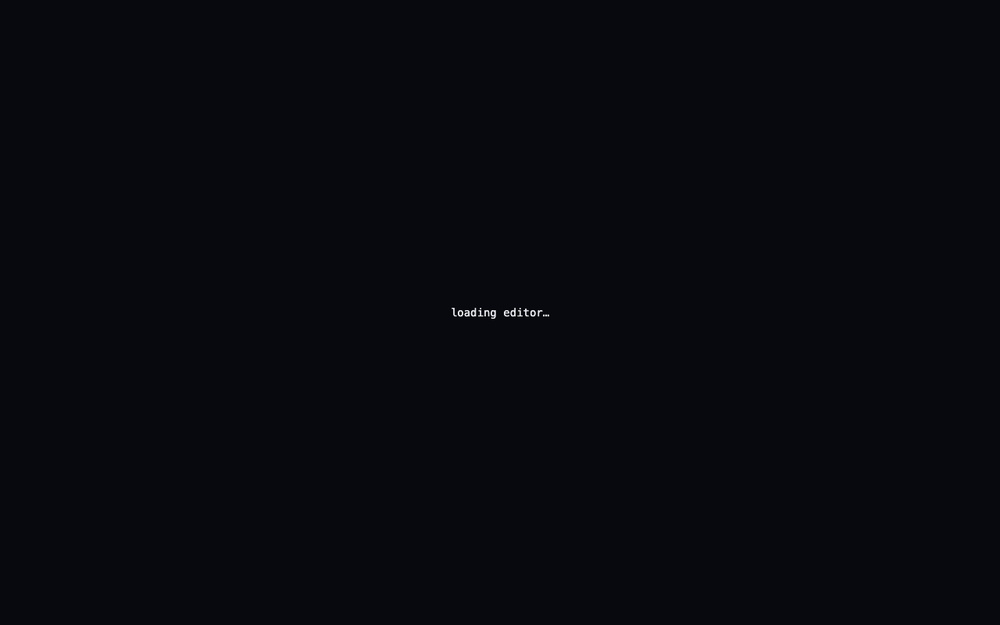
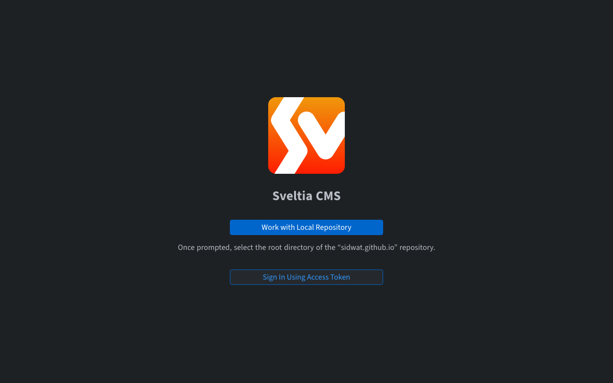
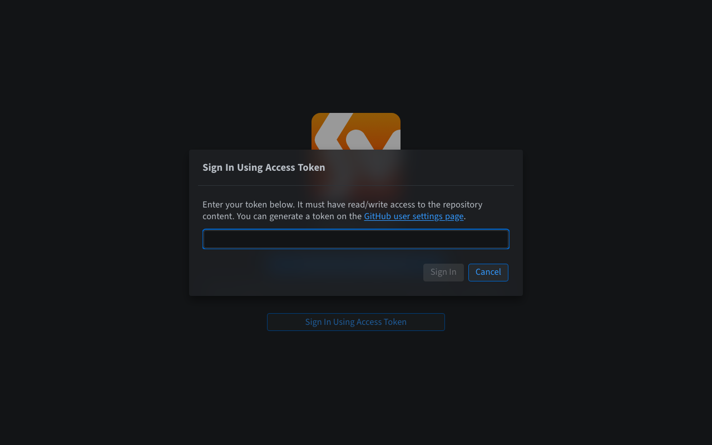
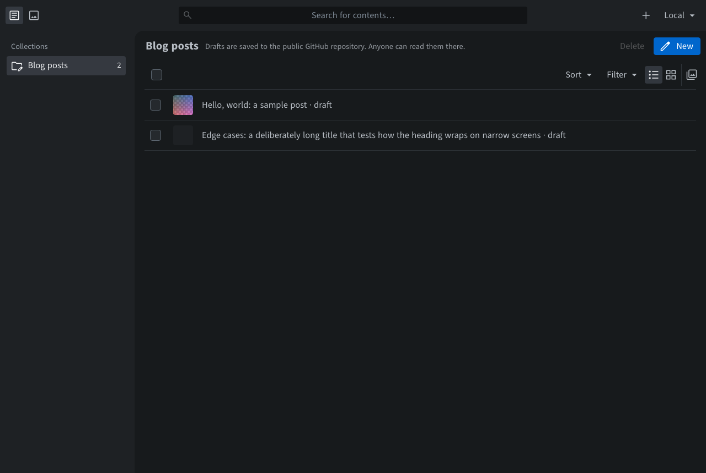
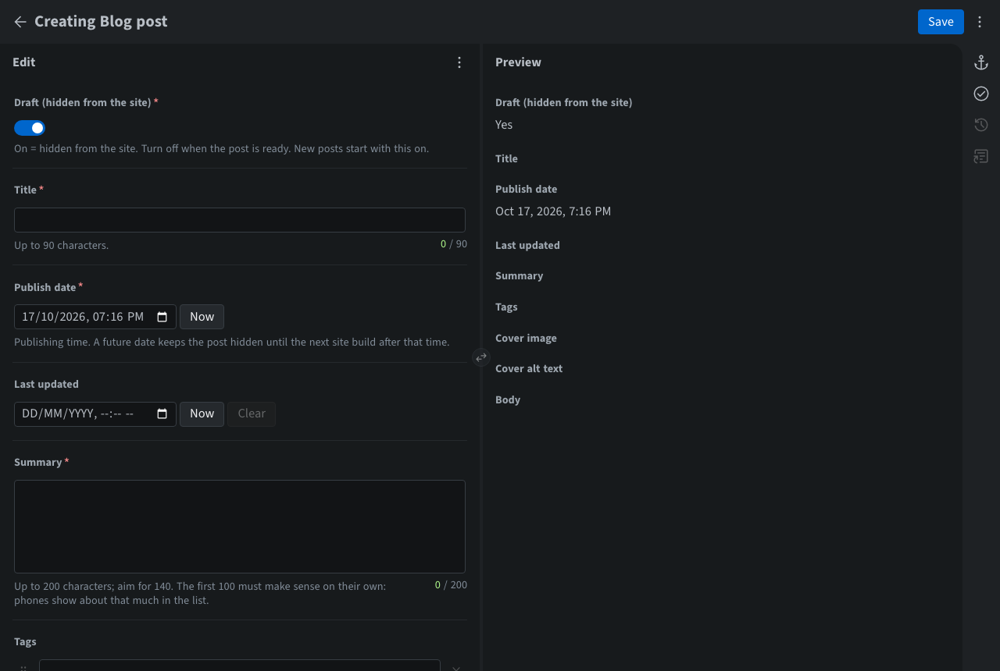
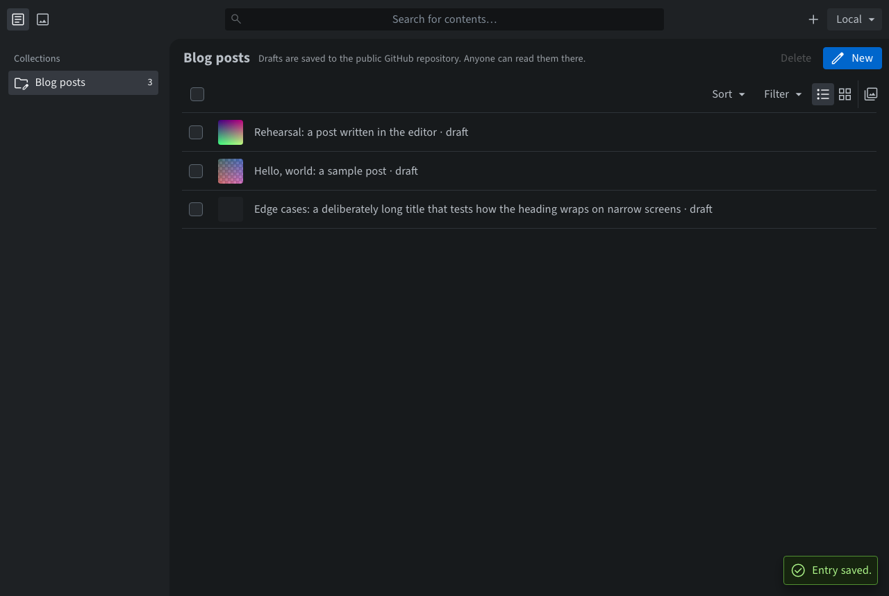
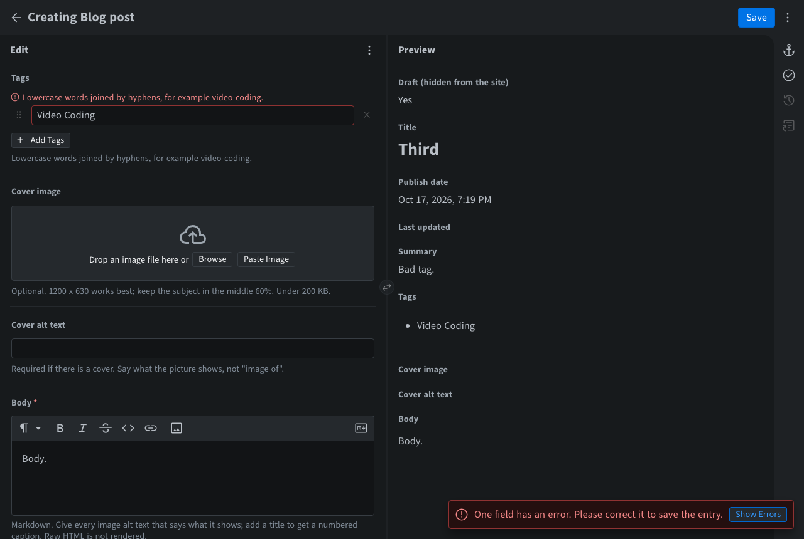
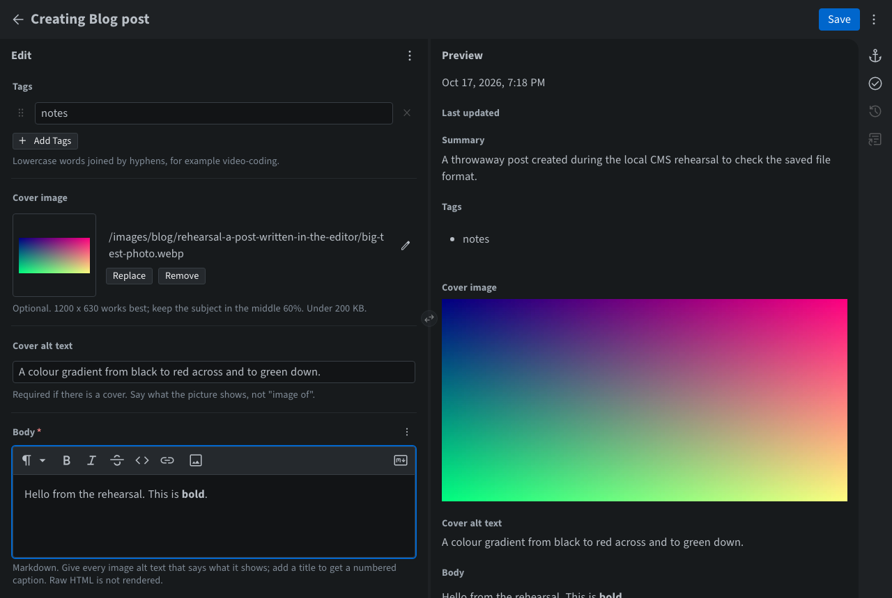
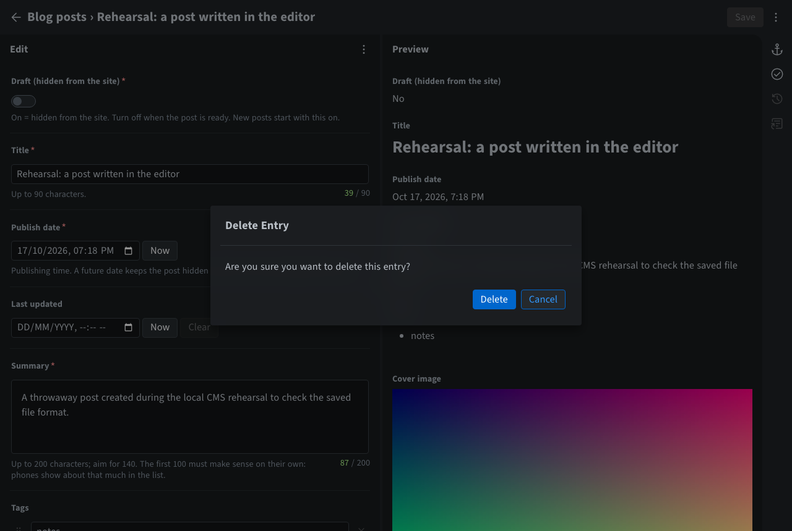

# Writing and publishing blog posts

For: the site owner. Last checked: 2026-10-17 (editor: Sveltia CMS 0.246.1).

> **Drafts are public.** The site's code and content live in a public GitHub repository. A post marked *Draft* is hidden from the **website**, but anyone can read it, and every earlier version of it, on GitHub. Never write anything in the editor that must stay private: no unpublished results, no confidential figures, no personal data, no private photos. Deleting a post later does not remove it from the repository's history.

You write in a browser editor at **<https://sidwat.github.io/admin/>**. Each save becomes a commit on the `master` branch. If the post is not a draft, the site rebuilds itself and the post goes live about **3 minutes** later. You never edit files by hand and never use a terminal.

The address `/admin/` is not linked anywhere and search engines are told to skip it. That is tidiness, **not security**: anyone can open the page. What protects the site is the GitHub token you sign in with, and nobody can sign in without one.

Screenshots marked *(local rehearsal)* were taken with the editor in its offline test mode, so the top-right corner says `Local` where yours shows your GitHub account. Screens that need a real sign-in are marked **[SCREENSHOT PLACEHOLDER]**, with a description of what you will see.

---

## 1. Before the first time: get a token

You need a GitHub *fine-grained personal access token* for this one repository. Follow [token-rotation.md](token-rotation.md) §1 (about 5 minutes). It expires after at most 90 days. When it does, you make a new one the same way.

## 2. Sign in

1. Open <https://sidwat.github.io/admin/> in Chrome, Edge, Firefox or Safari on your own computer. For a second or two you see `loading editor…` on a plain dark or light page; it follows your computer's light/dark setting.

   

2. The editor's sign-in screen appears with one button, **Sign In Using Access Token**. (When the editor runs on your own computer for testing, there is also a **Work with Local Repository** button. The live site doesn't show it.)

   

3. Click **Sign In Using Access Token**, paste your token into the box, and click **Sign In**.

   

4. You stay signed in on this browser until you sign out or the token expires. The token is saved in this browser only. **On a shared or public computer, always sign out afterwards** (§9).

**[SCREENSHOT PLACEHOLDER: first screen after signing in.]** You'll see the *Blog posts* list (§3) with your GitHub avatar at the top right instead of `Local`.

## 3. The post list

The left column lists one collection, **Blog posts**. The main area lists every post, newest first. Each row ends in `· draft` or `· published`. Use **Filter → Drafts / Published** to narrow the list, and **Sort** to sort by date, title or draft status. The line under the heading reminds you that drafts are public on GitHub.

The two posts already there, *Hello, world: a sample post* and *Edge cases…*, are test fixtures. They are drafts and never appear on the site. You may delete them once your first real post is live.

## 4. Write a new post

1. Click **New** (top right of the list). The editor opens with the form on the left and a live preview on the right.

   

2. Fill in the fields. The grey text under each field tells you what it wants:

   | Field | What to put | Notes |
   |---|---|---|
   | **Draft (hidden from the site)** | Leave **on** while writing | New posts start with this on, so nothing goes live by accident |
   | **Title** | Up to 90 characters | A counter shows how many you've used |
   | **Publish date** | Defaults to now. Shown in your local time and stored in UTC | A future date keeps the post hidden until the site next rebuilds after that time (see §7) |
   | **Last updated** | Leave empty for a new post | Set it when you make a meaningful change later |
   | **Summary** | Up to 200 characters; aim for 140 | Shown in the post list, search results and the RSS feed. The first 100 characters should make sense on their own |
   | **Tags** | Optional. One tag per item, lowercase words joined by hyphens, e.g. `video-coding` | `Video Coding` is rejected with a red message. Remove the empty item if you don't want tags, or just leave it empty |
   | **Cover image** | Optional. See §5 | |
   | **Cover alt text** | **Required if there is a cover.** Say what the picture shows | The editor doesn't enforce this, but the site build does (§8) |
   | **Body** | The post itself | Use the toolbar (bold, italic, code, link, image) or switch to plain Markdown with the **Edit in Markdown** button (the `M↓` icon at the right end of the toolbar). Raw HTML is not shown on the site |

3. **The web address.** It is made from the title when you first save, for example *My First Post* becomes `/blog/my-first-post/`. To choose it yourself, open the **anchor** icon (Slug panel) on the far right *before the first save*. After the first save it is fixed, because changing it would break links. Retitling the post later is fine; the address stays the same.

4. Click **Save** (top right). With Draft still on, this commits the draft to GitHub. The website doesn't change. You return to the list with a green *Entry saved* message.

   

If a field is wrong, Save shows it in red and nothing is saved:

## 5. Add images

- **Cover:** under *Cover image*, drag a file onto the box or click **Browse**. Then fill in **Cover alt text**. A wide picture works best (1200 × 630). Keep the subject in the middle, because some places crop the edges.
- **In the body:** click the **image** button in the Body toolbar, upload or pick a file, and give it alt text that says what it shows. If you add a *title*, it appears as a numbered caption.
- **What the editor does for you:** JPEG and PNG photos are shrunk to at most 1600 px wide or tall and converted to WebP before upload. That usually brings a phone photo well under 200 KB. Location (GPS) and camera data are removed at the same time. Animated GIFs are uploaded as they are, so keep them small.
- Images are saved to `public/images/blog/<post address>/` and are **public as soon as you save**, even while the post is a draft.

## 6. Publish

1. Open the post from the list.
2. Turn **Draft** off.
3. Check the date. If it is in the future, the post stays hidden until a later rebuild (§7).
4. Click **Save**.

**What "live in about 3 minutes" means.** Saving makes a commit on GitHub at once, and the editor says *saved* straight away. The site then rebuilds itself on GitHub's servers, which took about a minute in past runs. GitHub Pages can take a few more minutes to show the new version everywhere. To check:

1. Open <https://github.com/sidwat/sidwat.github.io/actions>. The top run, **Deploy to GitHub Pages**, is named after your post (for example `Blog: update "my-first-post"`).
2. A yellow dot means it is building. A green tick means it is live. A red cross means it failed (§8).
3. Open `https://sidwat.github.io/blog/` and reload; hold Shift while reloading if you still see the old page.

**[SCREENSHOT PLACEHOLDER: the Actions tab with a green "Deploy to GitHub Pages" run titled `Blog: update "…"`.]** You'll see a list of runs, newest on top, each with a status icon, the commit message and how long ago it ran.

## 7. Edit, unpublish, delete

- **Edit:** open the post, change it, **Save**. A published post updates about 3 minutes later. Set *Last updated* if the change matters to readers.
- **Unpublish:** open the post, turn **Draft** back on, **Save**. It disappears from the site, the RSS feed and the sitemap at the next deploy. It is still readable on GitHub.
- **Delete:** open the post, click the **⋮** menu at the top right, choose **Delete**, and confirm. This removes the post file. Its **images stay**. To remove them as well, open **Assets** (the picture icon at the top left), open the folder named after the post, select the images and delete them. Deleted files remain in the repository's history.

  

- **Scheduled posts:** there is no automatic daily rebuild (decision Q8). A post with a future date appears the next time the site rebuilds *after* that date, which usually means the next time you save any published change. To publish it right on time, open Actions → **Deploy to GitHub Pages** → **Run workflow** → `master` → **Run workflow** after the date has passed.

## 8. When a save doesn't show up on the site

The editor can't check everything. The site build checks the rest, and if anything is wrong it **stops and keeps the previous version of the site live**. Nothing half-broken is ever published. The common causes are a cover without alt text, a summary or title that is too long, or an image that is referenced but missing.

1. Open the Actions tab. The failed run has a red cross.
2. Click it, then click **build**, then the red **Run pnpm build** step.
3. Near the bottom, a line names the file and the field, for example:
   `content/blog/my-first-post.md: "coverAlt" is required when cover is set`
4. Go back to the editor, fix that field in that post, and **Save** again. A new run starts automatically.

More cases are in [troubleshooting.md](troubleshooting.md).

## 9. Signing out and safety

- **Sign out:** click your avatar (top right) → **Sign Out**. This removes the token from the browser.
- Only sign in on your own devices. Anyone who can use your browser profile while you are signed in can edit the site.
- If the editor ever offers a *sign in on mobile* QR code, don't use it near other people. The code contains your token.
- The editor may show a *new version available* notice. You can ignore it: the version is fixed on purpose, and an engineer updates it ([cms-reference.md](cms-reference.md) §2).
- If you think your token has leaked, revoke it right away: [token-rotation.md](token-rotation.md) §4.

## If this doesn't work

- The page stays on `loading editor…`, or shows **Could not load the editor.**: see [troubleshooting.md](troubleshooting.md) §1.
- Sign-in fails, or **Save** shows an error about permissions or authentication: your token has expired or lacks *Contents: Read and write*. Make a new one ([token-rotation.md](token-rotation.md) §2).
- The save worked but the site didn't change: §8 above, then [troubleshooting.md](troubleshooting.md) §3 and §4.
- Still stuck: open an issue in the repository describing what you clicked and what you saw. **Never paste your token** into an issue, an email or a chat.
