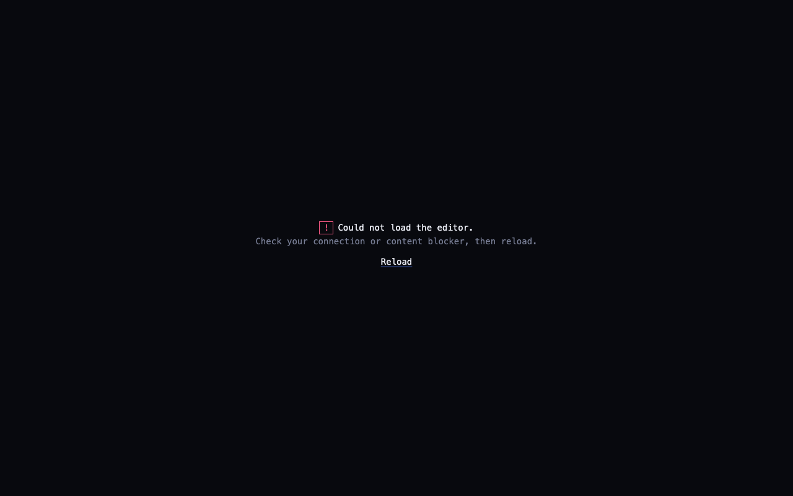

# Troubleshooting: blog editor, deploys and the contact form

For: the site owner. Last checked: 2026-10-17. Find the symptom, then follow the steps in order.

Two facts that make most problems less scary:

1. **A failed build never breaks the live site.** The deploy workflow has two jobs, *build* then *deploy*, and *deploy* only runs if *build* succeeded. When a build fails, the last good version stays online.
2. **Everything is in git.** Any change, including a deleted post, can be undone by reverting the commit on GitHub.

Where to look: **Actions** tab, <https://github.com/sidwat/sidwat.github.io/actions>, workflow **Deploy to GitHub Pages**.

---

## 1. The editor won't load

What you see at `/admin/`:

| Screen | Meaning |
|---|---|
| `loading editor…` for a second or two | Normal |
| `still loading… slow connection?` (after 8 seconds) | The editor script, about 2.5 MB from unpkg.com, is downloading slowly. Wait |
| **Could not load the editor.** with a **Reload** link | The script was blocked, the connection dropped, or 20 seconds passed without it loading |
| `The editor needs JavaScript.` | JavaScript is turned off in this browser |

Steps:

1. Click **Reload**.
2. Check you're online, then try a private window. If it works there, a browser extension is blocking it. Ad and script blockers (uBlock Origin, Privacy Badger, NoScript, Brave Shields) may block `unpkg.com` or `cdn.jsdelivr.net`. Allow those two for `sidwat.github.io`, or pause the blocker on `/admin/`.
3. Try another network. Some workplace or campus networks block CDNs.
4. Check <https://www.githubstatus.com>, and whether <https://unpkg.com> opens at all. If unpkg is down, wait and retry later.
5. If it fails every time, everywhere, for more than a day, the file on the CDN may no longer match the checksum the page expects. The browser refuses a changed file on purpose. Ask an engineer to follow `docs/runbooks/cms-reference.md` §2. Don't try to bypass it.

## 2. Sign-in or saving fails

| Message or behaviour | Likely cause | Fix |
|---|---|---|
| Sign-in is rejected | Token mistyped, expired or deleted | Create a new token: [token-rotation.md](token-rotation.md) §1 |
| Was signed in, now everything fails, or you're sent back to the sign-in screen | Token expired (90 days) | [token-rotation.md](token-rotation.md) §2 |
| Save fails: "Resource not accessible by personal access token", 403, or "permission" | Token lacks *Contents: Read and write*, or covers a different repository | Check it ([token-rotation.md](token-rotation.md) §3) and make a new one |
| Save fails after someone enabled **branch protection** on `master` | The editor commits straight to `master`, which is now blocked | Ask an engineer to switch the editor to its review workflow. The token then also needs *Pull requests: Read and write* |
| Save fails: "conflict", or the file "has been changed" | The same post was changed elsewhere (another tab, or an engineer) after you opened it | Copy your text somewhere safe, reload the editor, open the post again, re-apply your changes and save |
| Red text under a field, Save does nothing | A field is invalid: title over 90 characters, summary over 200, a tag that isn't lowercase-with-hyphens, or a required field left empty | Fix the field shown in red |

**[SCREENSHOT PLACEHOLDER: the editor's error notification after a failed save.]** It appears as a red banner or toast at the top or bottom of the editor with the GitHub error text. Your typed text is still in the form, so copy it before reloading.

## 3. The build is red (Actions shows a red cross)

1. Open the failed run → **build** → the step with the red cross. It is usually **Run pnpm build**.
2. Scroll to the bottom. Blog problems are printed one per line, naming the file and the field:
   - `content/blog/my-post.md: "coverAlt" is required when cover is set` → add Cover alt text.
   - `... "summary" is required` or `must be at most 200 characters` → fix the summary.
   - `... "date" is not a valid date` → pick the date again with the date picker.
   - `... must be lowercase-kebab-case` (a tag) → fix the tag, e.g. `video-coding`.
   - `... duplicate slug` → two posts have the same address. Delete or rename the newer one.
   - `... image "/images/blog/..." does not exist` (or `"cover" ... does not exist`) → the post points at an image that isn't there. Upload it again, or remove the reference from the post.
3. Fix it in the editor and **Save**. A new run starts by itself.
4. If the step that failed is **not** `pnpm build` (for example *Install*, *Setup*, *Upload artifact* or *Deploy*), it is probably a temporary GitHub problem. Check <https://www.githubstatus.com>, then on the run page click **Re-run jobs** → **Re-run failed jobs**. If it fails again, open an issue.

## 4. The post isn't on the site, but the build is green

Check in this order:

1. **Draft is still on.** Open the post in the editor and look at the Draft switch. In the post list it ends in `· draft`.
2. **The date is in the future.** Posts appear only after their date, at the next rebuild after it. There is no daily automatic rebuild (decision Q8). Run one by hand: Actions → **Deploy to GitHub Pages** → **Run workflow** → branch `master` → **Run workflow**.
3. **It hasn't finished yet.** The run takes about a minute, and GitHub Pages can take a few minutes more to update. Wait 5 minutes, then hard-reload the page (Shift + Reload) or try a private window.
4. **You're looking at the wrong address.** The address was made from the title when the post was first saved, and it never changes. Find it in the editor's Slug panel (anchor icon) or at <https://sidwat.github.io/blog/>.
5. **RSS readers** check the feed on their own schedule. That can take hours.

## 5. An image is too big, blurry or rejected

- The editor shrinks JPEG and PNG photos to at most 1600 px and converts them to WebP when you upload. If a photo still looks too heavy, crop it before uploading.
- **iPhone HEIC photos** are converted to WebP as well. Outside Safari, the first one takes a moment while the editor downloads a converter (about 300 KB). If a HEIC photo is rejected, export it as JPEG first (Photos → File → Export) and upload that.
- **Animated GIFs** are uploaded unchanged. Keep them under about 1 MB, or use a still image.
- An image doesn't show on the site but does show in the editor: check the build (§3). A missing image fails the build by name.
- Remember: an uploaded image is **public as soon as you save**, even in a draft.

## 6. I deleted or broke something by mistake

1. Open <https://github.com/sidwat/sidwat.github.io/commits/master> and find the editor's commit (it starts with `Blog:`).
2. Open it and check the change is the one you want to undo.
3. Revert it: GitHub's web interface has no one-click revert for a single commit pushed straight to `master`, so ask an engineer to run `git revert <commit>`. Or, for a deleted post, recreate it in the editor using the old text from the commit page.
4. The site redeploys after the revert.

## 7. The contact form isn't delivering

Full details are in [contact-form.md](contact-form.md). In short:

1. **Nothing arrives:** check Spam/Promotions. Look in the Web3Forms dashboard (<https://app.web3forms.com>) to see whether the submission reached them.
2. **Every visitor sees "couldn't send" with your email link:** the site was built without the key, or Web3Forms rejected the domain. Check that the repository variables `CONTACT_ACCESS_KEY` and `CONTACT_ENDPOINT` exist (Settings → Secrets and variables → Actions → **Variables**). Then check that a deploy has run since they were set: re-run **Deploy to GitHub Pages** if unsure. See [contact-form.md](contact-form.md) §4, "Known risk".
3. **"Too many messages right now":** the monthly free allowance is used up, or one visitor sent too many in an hour. Visitors still get your email link. Check the dashboard for bot traffic.
4. **Spam is getting through:** see [contact-form.md](contact-form.md) §3. Turning on hCaptcha needs a design and code change, so raise it rather than flipping it on in the dashboard.

## If this doesn't work

Open an issue at <https://github.com/sidwat/sidwat.github.io/issues> with:

- what you were doing and the time;
- the exact message, or a link to the red Actions run;
- your browser and device.

**Never include your GitHub token or any password.** The contact access key is public by design, but you don't need to include it either.
